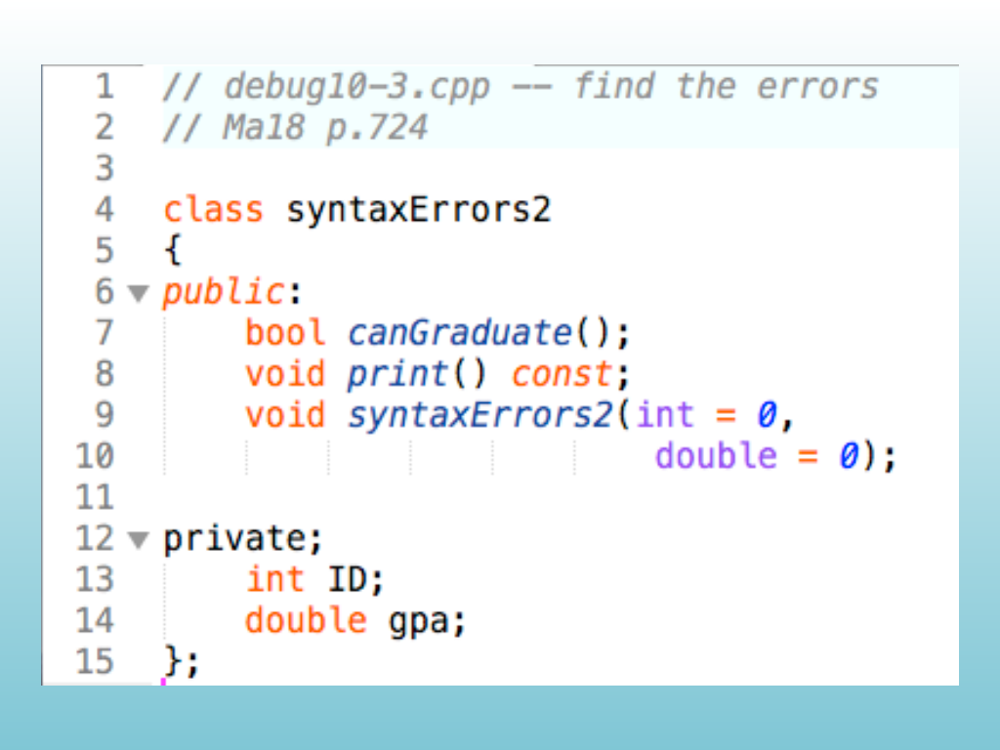

<!-- Topic 2: Static Members -->
<!-- Slides 21-29 -->

# Static Members

::: notes
Slides 21-29
:::

<!-- Slide 21 -->

---

## Problem

How can we create one variable that is shared across every instance of a class?

<!-- Slide 22 -->

---

## Counting Instances

::: {.columns}
::: {.column width="60%"}

~~~cpp
class Example {
private:
    int x;
    static int count;

public:
    Example(int value) {
        x = value;
        ++count;
    }

    static int getCount() {
        return count;
    }
};

int Example::count = 0;

int main() {
    Example obj1(10);
    Example obj2(20);

    cout << "Number of instances: "
         << obj1.getCount() << endl;
    return 0;
}
~~~

:::
::: {.column width="40%"}
**Answer**

<code>count</code> belongs to the class, so every constructor call updates the same variable.

With two objects, <code>getCount()</code> reports <code>2</code>.
:::
:::

<!-- Slide 23 -->

---

## Accessing a Static Member

::: {.columns}
::: {.column width="60%"}

~~~cpp
class Example {
private:
    static int count;

public:
    Example() { ++count; }

    static int getCount() {
        return count;
    }
};

int Example::count = 0;

int main() {
    cout << Example::getCount() << endl;

    Example obj1;
    Example obj2;

    cout << Example::getCount() << endl;
    return 0;
}
~~~

:::
::: {.column width="40%"}
**Answer**

A static member function can be called through the class name.

The first call reports <code>0</code>. After constructing two objects, the second call reports <code>2</code>.
:::
:::

<!-- Slide 24 -->

---

## Static Members

- A static member can be called even when no object instance exists.
- A static member function can directly access static data members, other static members, and functions outside the class.
- A static member function does not have a current object, so it cannot directly use ordinary non-static data members.

<!-- Slide 25 -->

---

## Gang of Four Design Patterns

{width="100%" fig-alt="Gang of Four design patterns"}

::: notes
The slide catalog permits the source graphic for this slide.
:::

<!-- Slide 26 -->

---

## Static Initialization

::: {.columns}
::: {.column width="60%"}

~~~cpp
class D6 {
public:
    int x;
    static bool isInitialized;

    D6() {
        if (!isInitialized) {
            srand(static_cast<unsigned>(time(nullptr)));
            isInitialized = true;
            cout << "Init code run" << endl;
        }

        x = rand() % 6 + 1;
    }
};

bool D6::isInitialized = false;

int main() {
    D6 a;
    D6 b;
    cout << a.x << endl;
    cout << b.x << endl;
    return 0;
}
~~~

:::
::: {.column width="40%"}
**Answer**

The first constructor call performs the shared initialization and sets the static flag.

Later objects skip that block. The initialization message appears once, followed by one random value for each object.
:::
:::

<!-- Slide 27 -->

---

## Shared Initialization

::: {.columns}
::: {.column width="60%"}

~~~cpp
class D6 {
public:
    int x;

    D6(bool& initialized) {
        if (!initialized) {
            srand(static_cast<unsigned>(time(nullptr)));
            initialized = true;
            cout << "Init code run" << endl;
        }

        x = rand() % 6 + 1;
    }
};

int main() {
    bool initialized = false;
    D6 a(initialized);
    D6 b(initialized);

    cout << a.x << endl;
    cout << b.x << endl;
    return 0;
}
~~~

:::
::: {.column width="40%"}
**Answer**

The two objects receive the same initialization state by reference.

The first object changes the shared flag. The second object sees that the flag is already true and does not repeat the initialization.
:::
:::

<!-- Slide 28 -->

---

## Static Members Example

~~~cpp
#include <iostream>
using namespace std;

class Counter {
private:
    static int total;

public:
    Counter() {
        ++total;
    }

    static void printTotal() {
        cout << "Total objects: " << total << endl;
    }
};

int Counter::total = 0;

int main() {
    Counter::printTotal();
    Counter first;
    Counter second;
    Counter::printTotal();

    return 0;
}
~~~

Static data is shared. Ordinary data members remain separate for each object.

<!-- Slide 29 -->
