<!-- Course framing is part of the stitched deck, not an instructional topic. -->

# Last Time

::: {.incremental}
+ **The this Pointer and Constant Member Functions**
+ **Static Members**
+ **Operator Overloading**
+ **Friends of Classes**
:::

::: notes
Non-activity topics from p400_lecture_07.01.
:::

<!-- Slide 1 -->

# Course Framing

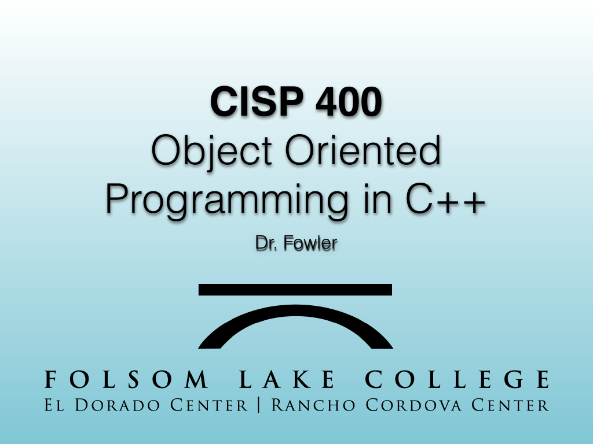{width="100%" fig-alt="CISP 400"}

::: notes
Slides 2–9
Source slide 1 from the authoritative PDF.
:::

<!-- Slide 2 -->

---

## Source Slide 2

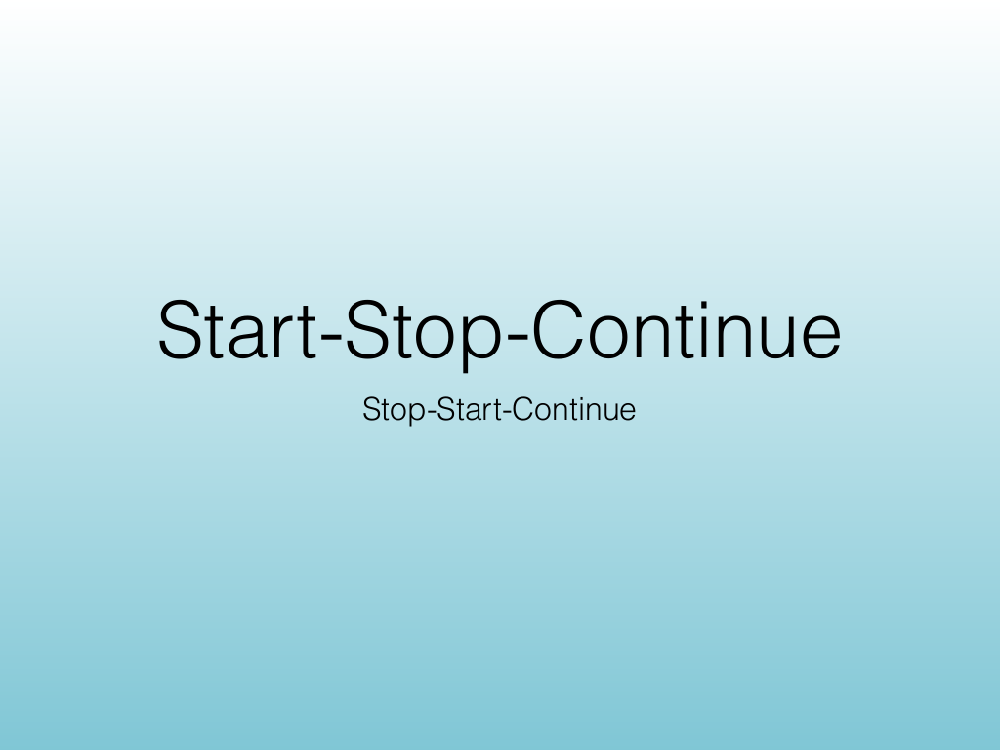{width="100%" fig-alt="Start-Stop-Continue"}

<!-- Slide 3 -->

---

## Source Slide 3

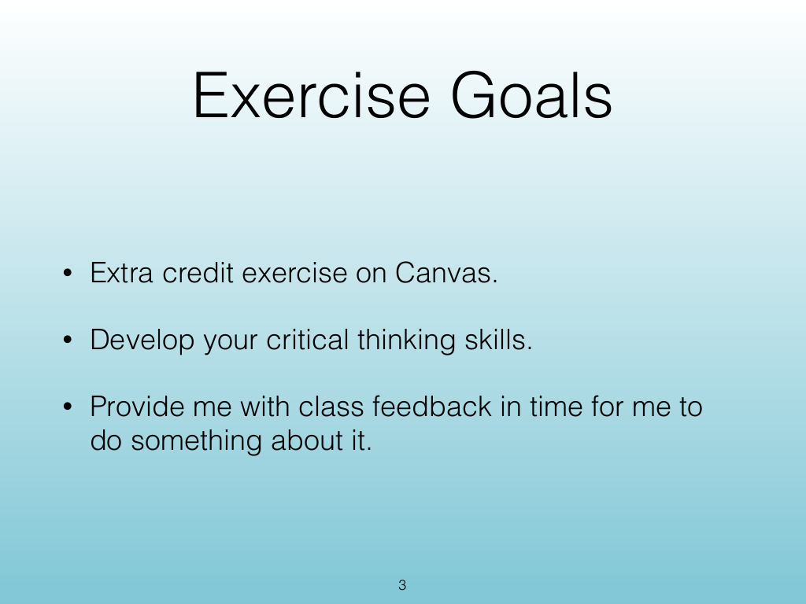{width="100%" fig-alt="Exercise Goals"}

<!-- Slide 4 -->

---

## Source Slide 4

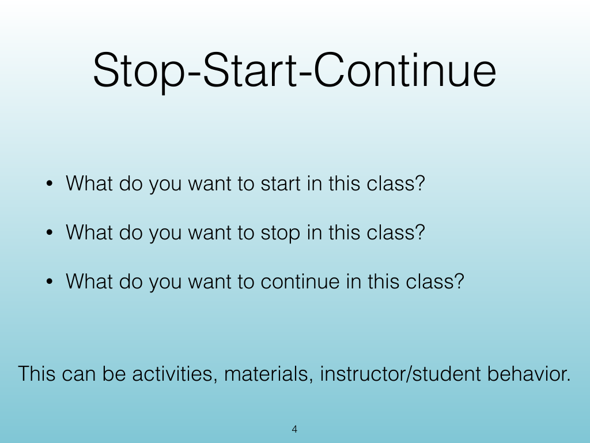{width="100%" fig-alt="Stop-Start-Continue"}

<!-- Slide 5 -->

---

## Source Slide 5

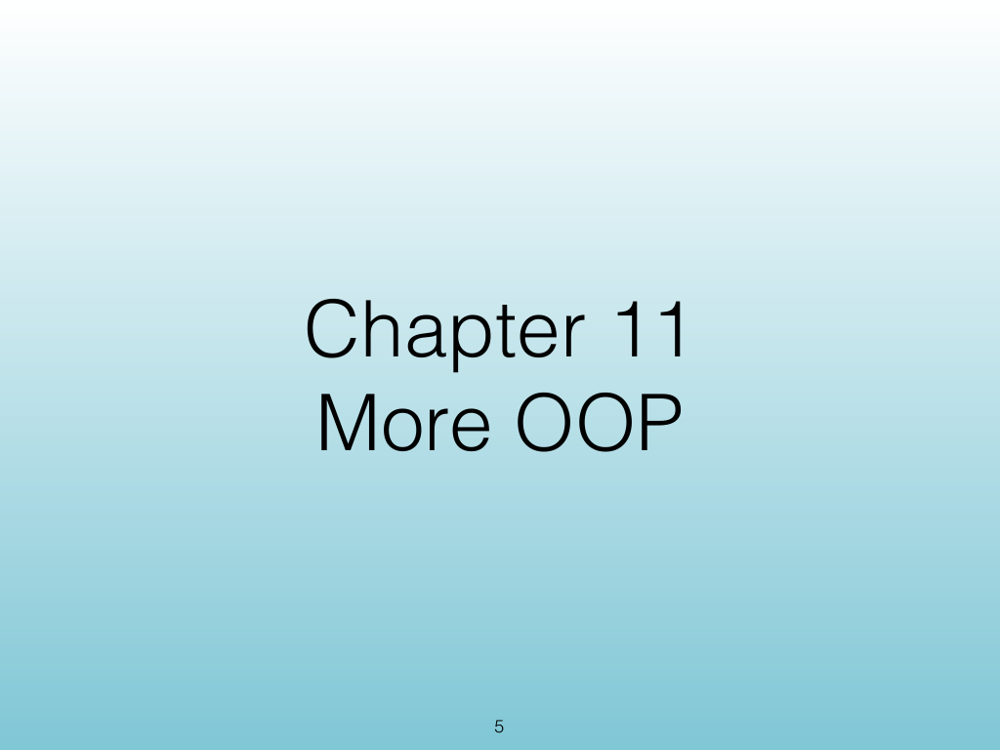{width="100%" fig-alt="Chapter 11"}

<!-- Slide 6 -->

---

## Source Slide 6

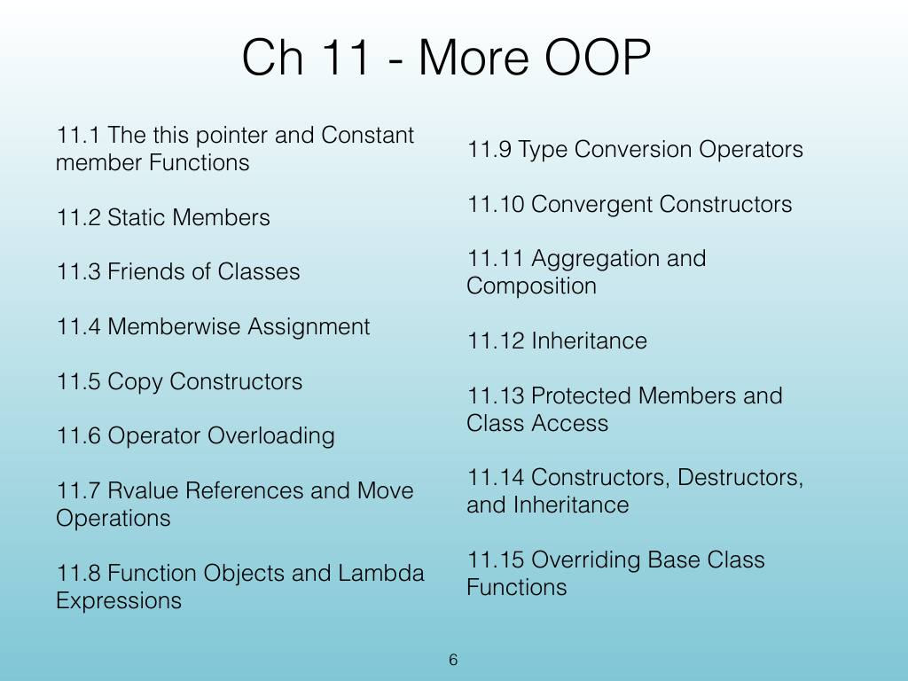{width="100%" fig-alt="Ch 11 - More OOP"}

<!-- Slide 7 -->

---

## Source Slide 7

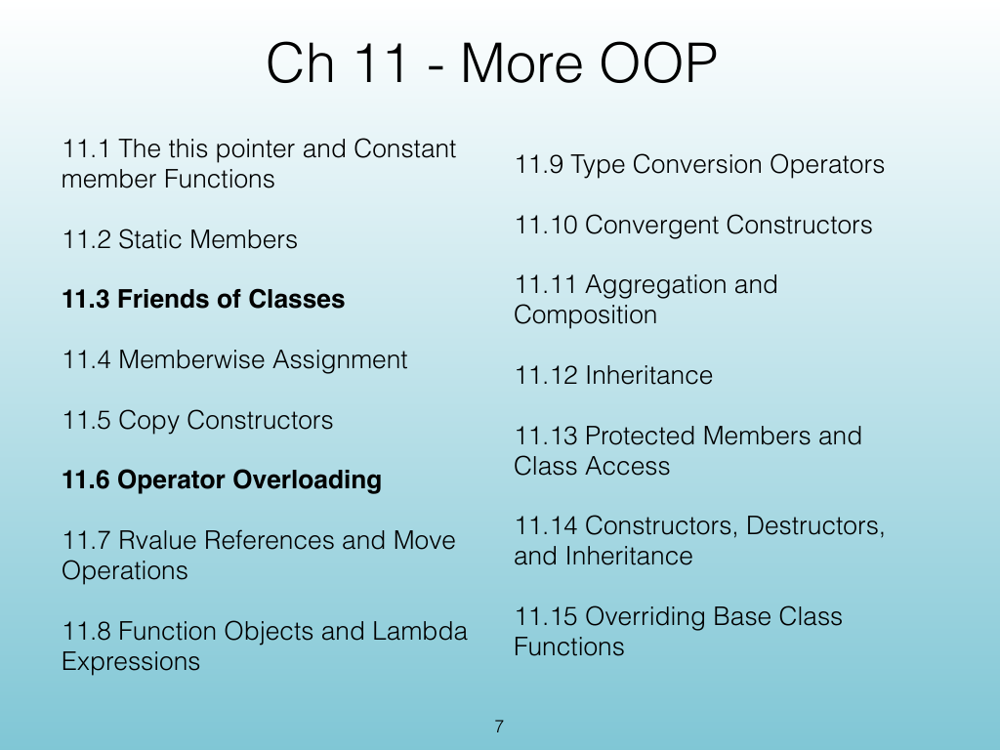{width="100%" fig-alt="Ch 11 - More OOP"}

<!-- Slide 8 -->

---

## Source Slide 8

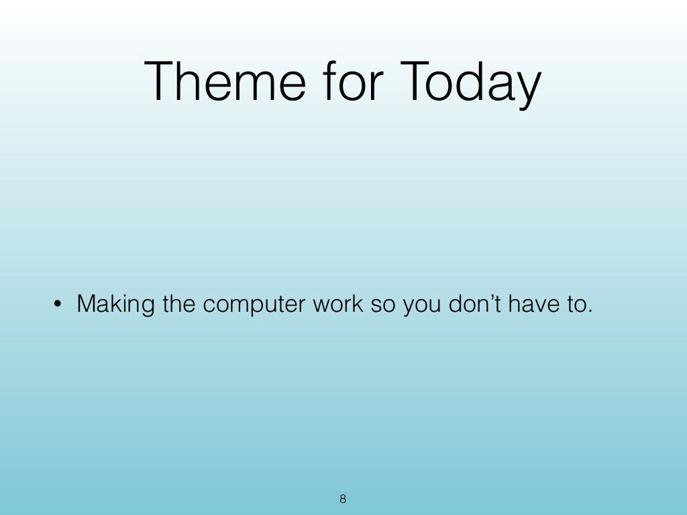{width="100%" fig-alt="Theme for Today"}

<!-- Slide 9 -->






# Code Together

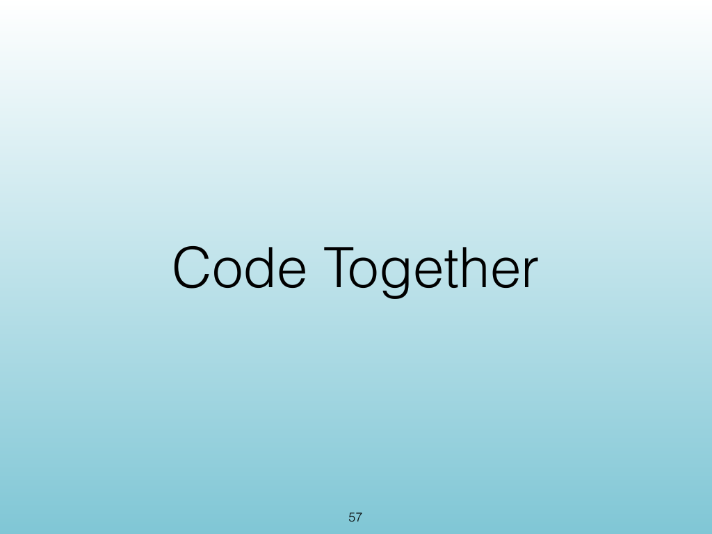{width="100%" fig-alt="Code Together"}

::: notes
Slides 33–35
Source slide 57 from the authoritative PDF.
:::

<!-- Slide 33 -->

---

## Source Slide 58

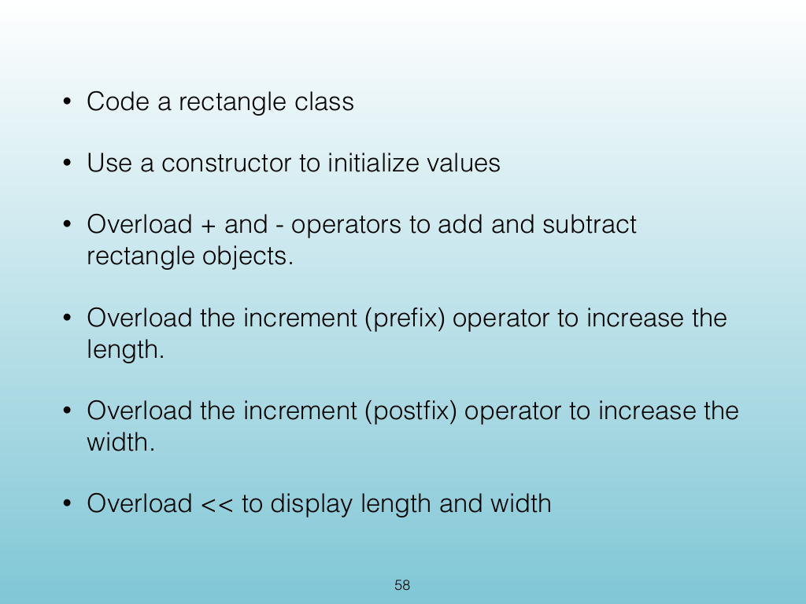{width="100%" fig-alt="Code a rectangle class"}

<!-- Slide 34 -->

---

## Source Slide 59

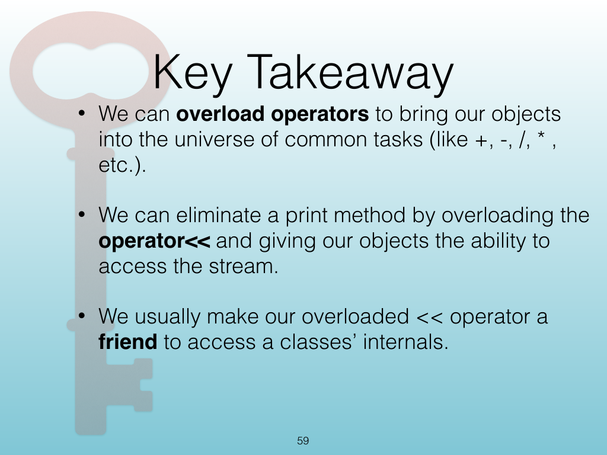{width="100%" fig-alt="Key Takeaway"}

<!-- Slide 35 -->


