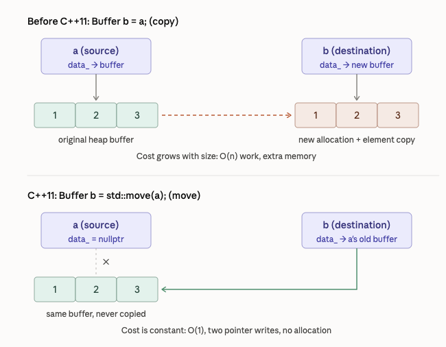

<!-- Topic 1: Moving & Copying -->
<!-- Slides 5–26 -->

# Moving & Copying
<!-- Slide 5 -->

## Why do copy and move operations matter?

Copying and moving are two different ways for C++ objects to transfer data or resource ownership. The distinction matters most when an object manages expensive memory or another resource.

::: notes
Slides 5–26
Opening question. [Marker: Value Added] [Marker: Motivating Question]
:::

<!-- Slide 6 -->

---

## Background: C++ gives you a choice

- Copying creates another object with its own state.
- Moving transfers an existing resource into a new object when the source is no longer needed.

The language exposes both choices so a class can preserve correctness without paying for unnecessary duplication.

<!-- Slide 7 -->

---

## Before C++11: copying was the only handoff

Returning a large `vector`, inserting a `string` into a container, or passing an object by value could allocate memory and duplicate every element—even when the source was a temporary about to disappear.

An rvalue reference gives overload resolution a way to recognize that temporary and select a cheaper path.

<!-- Slide 8 -->

---

## Moving a resource

{width="72%" fig-alt="A resource transferred from one buffer object to another"}

::: notes
[Graphic suggestion: redraw the buffer ownership transfer as two labeled object boxes and one heap allocation.]
:::

<!-- Slide 9 -->

---

## What does moving make possible?

Moving & Copying lets us answer four questions:

1. What happens when C++ copies an object?
2. Why can moving be faster?
3. What does resource ownership have to do with correctness?
4. How does C++ recognize an object that can be moved from?

<!-- Slide 10 -->

---

## C++ copies by default

- `b = a` creates an independent object in C++.
- For a `vector` with a million elements, that means allocating memory and copying every element.
- Passing or returning by value can therefore do substantial work even when the syntax looks simple.

<!-- Slide 11 -->

---

## Performance

Programs constantly create temporary objects: function return values, intermediate results such as `a + b`, and objects inserted into containers.

Moving can hand off the expensive resource—often a pointer to heap memory—in constant time instead of copying every element.

<!-- Slide 12 -->

---

## Correctness

If a class owns a resource through a raw pointer, the compiler’s default copy can duplicate the pointer instead of the resource. Two objects then believe they own the same allocation, which can produce a double free or a crash.

Copy and move operations are part of the class’s ownership contract.

<!-- Slide 13 -->

---

## Some things should not be copied

- `unique_ptr` represents sole ownership.
- A thread, mutex, or file stream represents an operating-system resource that may not have a meaningful duplicate.
- These types are often move-only: ownership can transfer, but the resource cannot be cloned.

<!-- Slide 14 -->

---

## The rule of zero

Prefer members that already manage themselves, such as `string`, `vector`, and `unique_ptr`. The compiler can then generate correct copy and move operations for the containing class.

Write custom operations only when the class directly manages a raw resource.

<!-- Slide 15 -->

---

## Practical guidance

- Pass a large object by `const&` when the function only needs to read it.
- Treat returning by value as efficient because move operations and copy elision avoid unnecessary duplication.
- Give raw-resource owners deliberate copy and move behavior.

<!-- Slide 16 -->

---

## Into the weeds

The next slides separate two ideas that are often confused:

- **Value category:** how an expression behaves—usually as an lvalue or rvalue.
- **Reference type:** what a parameter or variable is allowed to bind to.

<!-- Slide 17 -->

---

## lvalues

An lvalue is an expression that identifies an object with a location we can use again. Named variables are the common case.

```{.cpp}
int count = 5;
count = 6;       // count identifies a lasting object
&count;          // its address can be taken
```

<!-- Slide 18 -->

---

## rvalues

An rvalue is an expression that usually produces a temporary value rather than naming a lasting object.

```{.cpp}
int total = count + 3;   // count + 3 is a temporary result
makeGreeting();          // a returned temporary
```

<!-- Slide 19 -->

---

## A quick test

- If you can usually take the expression’s address with `&`, treat it as an lvalue.
- If it is a temporary result with no lasting identity, treat it as an rvalue.

This test is useful for orientation, but the language rules—not the shortcut—control overload resolution.

<!-- Slide 20 -->

---

## Value categories in code

```{.cpp}
int x = 5;        // x is an lvalue; 5 is an rvalue
int y = x + 3;    // x + 3 is an rvalue

&x;               // valid: x has an address
&5;               // error: a literal has no address
&(x + 3);         // error: a temporary has no address
x + 3 = 10;       // error: an rvalue is not assignable
```

<!-- Slide 21 -->

---

## Why the distinction matters

An rvalue is about to disappear, so no other part of the program should depend on its current resource. C++ can therefore offer an overload that takes the resource instead of copying it.

The syntax for that overload is an rvalue reference: `T&&`.

<!-- Slide 22 -->

---

## Overloading on value category

```{.cpp}
#include <iostream>
#include <string>
#include <utility>
using namespace std;

void show(const string& s) {
    cout << "lvalue overload: " << s << '\n';
}

void show(string&& s) {
    cout << "rvalue overload: " << s << '\n';
}
```

::: notes
The two overloads give the compiler separate code paths for an object that remains owned by the caller and a temporary whose resources can be transferred.
:::

<!-- Slide 23 -->

---

## The compiler chooses the overload

```{.cpp}
string name = "Ada";

show(name);                  // lvalue overload
show(string("temporary"));  // rvalue overload
show(makeGreeting());        // rvalue overload
show(name + " Lovelace");    // rvalue overload
```

The caller still owns `name`. The other expressions create temporaries, so the `&&` overload is eligible.

<!-- Slide 24 -->

---

## `move` does not move anything

```{.cpp}
show(name);            // lvalue overload
show(move(name));       // rvalue overload
```

`move` is a cast that treats a named object as disposable. The selected move operation determines whether any resource is actually transferred.

<!-- Slide 25 -->

---

## Summary

```{.cpp}
void show(string&& s) {
    // s has a name, so the expression s is an lvalue
    consume(move(s));
}
```

The type tells us what `s` can bind to, while the expression’s value category tells us how `s` behaves at the point of use. Use `move(s)` to pass a named rvalue reference on as an rvalue; copying duplicates state, while moving transfers ownership.

<!-- Slide 26 -->
