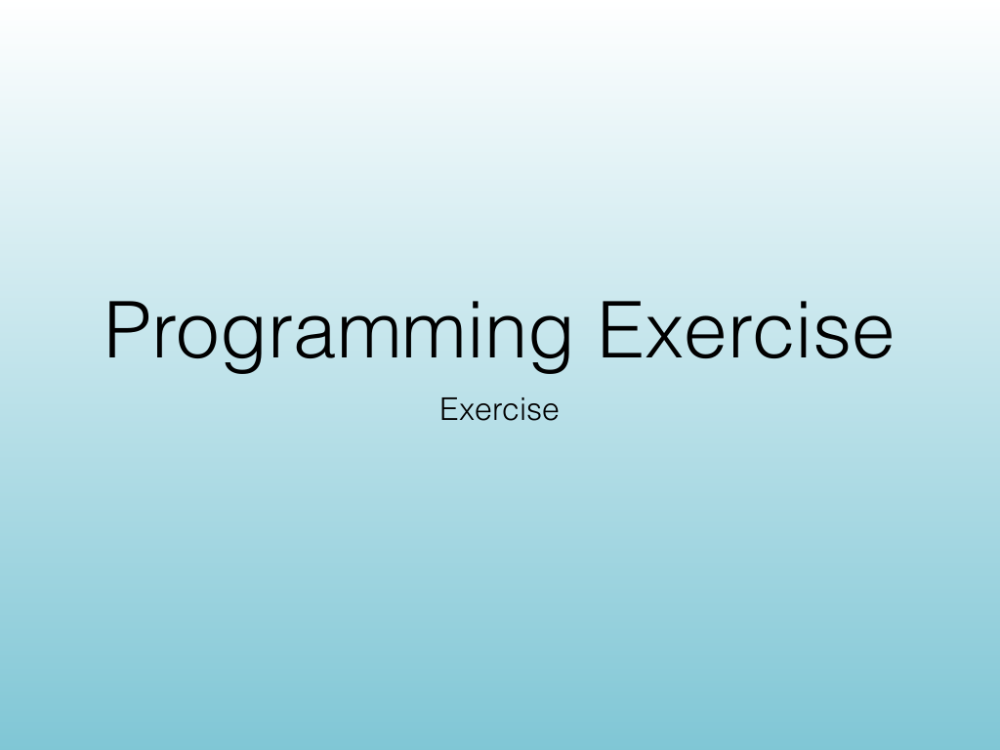
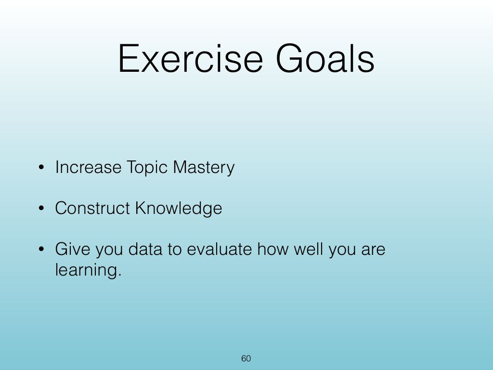
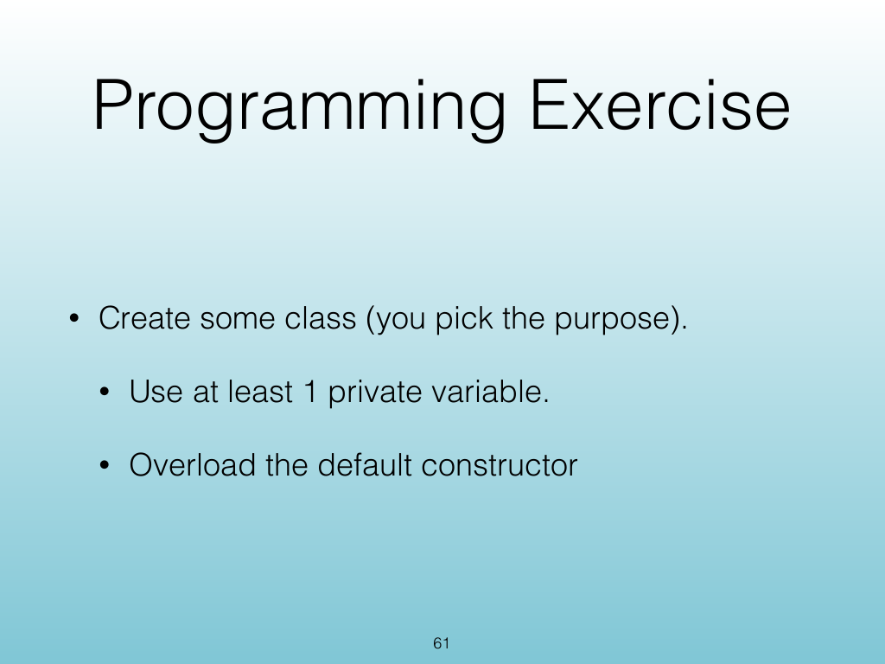
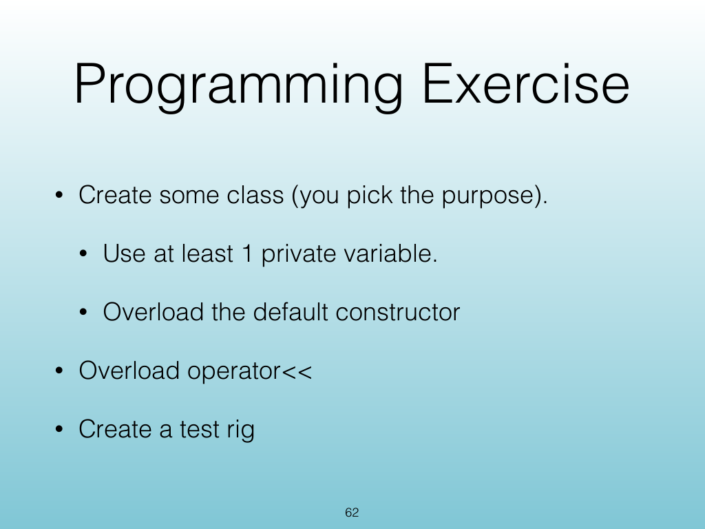
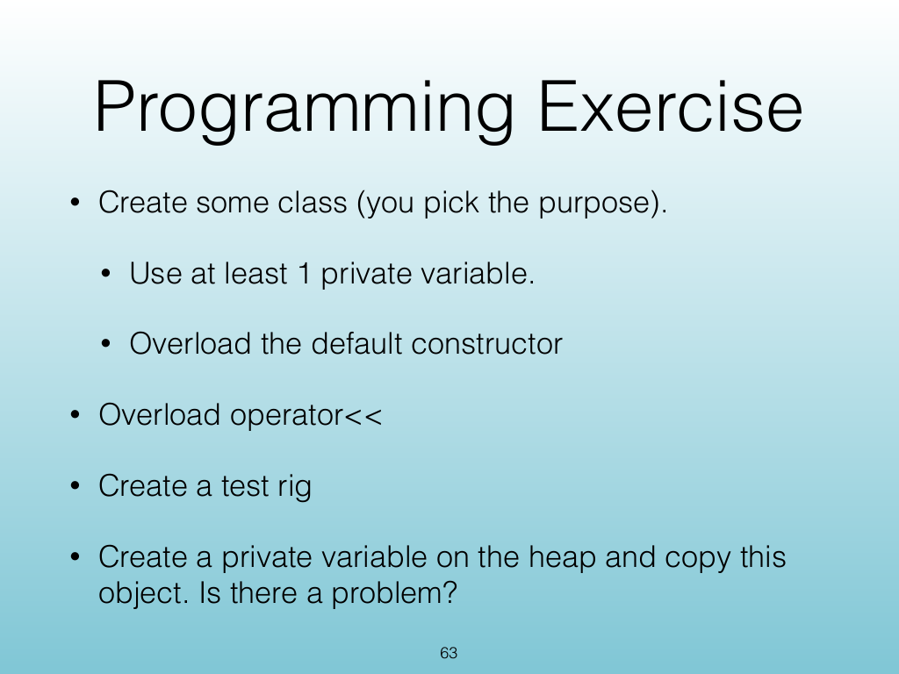

<!-- Topic: Programming Exercise -->
<!-- Slides 83–87 -->

# Programming Exercise

{width="100%" fig-alt="Programming Exercise"}

::: notes
Slides 83–87
Source slide 59 from the lecture source images.
:::

<!-- Slide 83 -->

---

## Source Slide 60

{width="100%" fig-alt="Exercise Goals"}

<!-- Slide 84 -->

---

## Source Slide 61

{width="100%" fig-alt="Programming Exercise"}

<!-- Slide 85 -->

---

## Source Slide 62

{width="100%" fig-alt="Programming Exercise"}

<!-- Slide 86 -->

---

## Source Slide 63

{width="100%" fig-alt="Programming Exercise"}

<!-- Slide 87 -->
