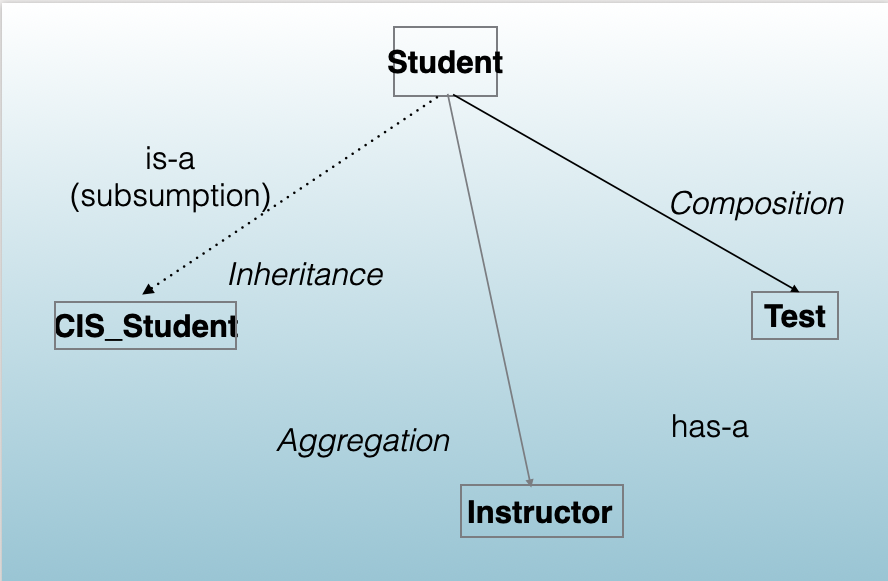
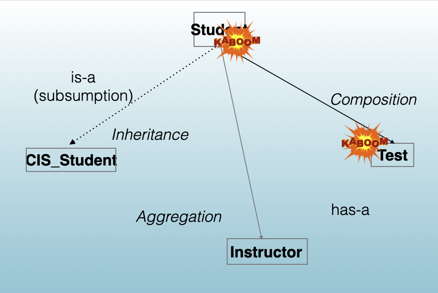
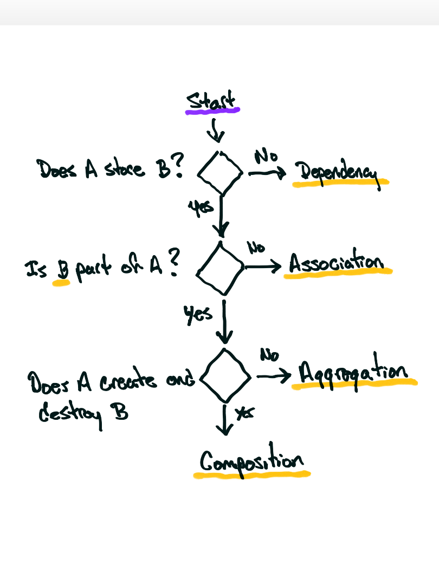

<!-- Topic 2: Class Relationships -->
<!-- Slides 17–34 -->

# Class Relationships
<!-- Slide 16 -->

## Relationships

| Relationship Type | Relationship Example | Key Characteristic |
|---|---|---|
| Association | Student ↔ Course | General uses relationship |
| Aggregation | Library → Book | Weak ownership (has-a) |
| Composition | Car → Engine | Strong ownership (part-of) |
| Inheritance | Dog → Animal | Hierarchical (is-a) |
| Dependency | Printer → Document | Temporary use |
| Realization | Bird → Flyable | Implements behavior |
| Friendship | Matrix ↔ Calculator | Explicit access granting |

::: notes
Slides 17–34

This is the table from 05.02. Conversions are one way an object interacts with other types; relationships are the other: an object can use, know about, or contain another object.
:::

<!-- Slide 17 -->

---

## Relationships

- Dependency
- Association
- Aggregation
- Composition
- Inheritance

::: notes
The five relationships this lecture and the next one use. Realization needs inheritance, and friendship was covered in 07.01 and 07.02.
:::

<!-- Slide 18 -->

---

## Focus on These 3 Relationships

{width="80%" fig-align="center" fig-alt="Student with inheritance to CIS_Student, aggregation to Instructor, and composition to Test"}

::: notes
Inheritance is is-a: a CIS_Student is a Student (11.02). Aggregation and composition are both has-a.

Discussion: the diagram labels Student to Instructor as aggregation. Come back to it after the relationship algorithm slide and ask students to run it through the questions. An instructor is not part of a student, so the algorithm says association. Let them argue it.
:::

<!-- Slide 19 -->

---

## Focus on These 3 Relationships

{width="80%" fig-align="center" fig-alt="The same diagram with Student and Test destroyed together"}

::: notes
Destroy the Student and its composed Test goes with it. The Instructor and the CIS_Student class are not destroyed, because the Student does not own them.
:::

<!-- Slide 20 -->

---

## Front-End and Back-End Classes

{height="480" fig-align="center" fig-alt="Front-end class object A pointing to back-end class object B"}

::: notes
The front-end class is the one you instantiate; the back-end object goes along for the ride as a member. In composition the back-end object lives and dies with the front-end object; in aggregation it exists on its own and the front-end object only points at it.
:::

<!-- Slide 21 -->

---

## Composition

- A class holds an object of another class as a member, and owns it.
- The part is created with the whole and destroyed with the whole.

::: notes
Reading: learncpp 23.2, Composition. Topic 3 builds composition with member initializer lists.
:::

<!-- Slide 22 -->

---

## What Does Composition Do For Me?

- Allows us to make use of behavior in other classes.

::: notes

:::

<!-- Slide 23 -->

---

## Aggregation

- A class stores a pointer or reference to an object of another class that is part of it.
- The class neither creates nor destroys that object; it exists on its own.

::: notes
Reading: learncpp 23.3, Aggregation. The part can outlive the whole and can be shared.
:::

<!-- Slide 24 -->

---

## What Does Aggregation Do For Me?

- Allows us to make use of behavior in other classes.
- We can change this behavior by changing the classes.

::: notes
Because the part is supplied from outside, a different object can be plugged in: give the Car a different GPS and its behavior changes without changing the Car.
:::

<!-- Slide 25 -->

---

## Inheritance

- A new class is built from an existing class.
- The derived class is a kind of the base class and gets its members.

::: notes
Preview only: 11.02 teaches inheritance. Reading: learncpp 24.1, Introduction to inheritance.
:::

<!-- Slide 26 -->

---

## What Does Inheritance Do For Me?

- Inheritance allows us to write code in one class …
- … and use that same exact code in many other classes.
- And we can mix and match what code we want those other classes to use.

::: notes

:::

<!-- Slide 27 -->

---

## Relationship Algorithm

{height="500" fig-align="center" fig-alt="Flowchart: does A store B, is B part of A, does A create and destroy B"}

::: notes
The questions in order: Does A store B? No means dependency. Is B part of A? No means association. Does A create and destroy B? Yes means composition; no means aggregation, where A neither creates nor destroys B.

Revisit the Student to Instructor arrow from the Focus on These 3 Relationships slide with these questions.
:::

<!-- Slide 28 -->

---

## Name That Relationship

:::: {.columns}

::: {.column width="50%" style="font-size: 60%;"}
**A**

~~~cpp
class Printer {
public:
    void print(const Document& doc);
};
~~~

**B**

~~~cpp
class Car {
private:
    Engine engine;
};
~~~
:::

::: {.column width="50%" style="font-size: 60%;"}
**C**

~~~cpp
class Driver {
private:
    Car* car;
};
~~~

**D**

~~~cpp
class Department {
private:
    Teacher* teachers[10];
};
~~~
:::

::::

::: notes
Have students label each snippet using the four questions before advancing. C and D have the same code shape, so the answer depends on whether B is part of A.
:::

<!-- Slide 29 -->

---

## Name That Relationship: Answers

| Snippet | Stores B? | Part of A? | A creates and destroys B? | Relationship |
|---|---|---|---|---|
| A: `Printer`, `Document` | No | | | Dependency |
| B: `Car`, `Engine` | Yes | Yes | Yes, as a member object | Composition |
| C: `Driver`, `Car` | Yes | No | | Association |
| D: `Department`, `Teacher` | Yes | Yes | No: teachers are hired elsewhere | Aggregation |

::: notes
A teacher who leaves the department still exists, which is the test for aggregation. The Department and Teacher example comes from learncpp 23.3, Aggregation.
:::

<!-- Slide 30 -->

---

## Same Member, Different Relationship

:::: {.columns}

::: {.column width="50%" style="font-size: 60%;"}
**Composition: Car creates and deletes the engine**

~~~cpp
class Car {
private:
    Engine* engine;

public:
    Car() { engine = new Engine; }
    ~Car() { delete engine; }
};
~~~
:::

::: {.column width="50%" style="font-size: 60%;"}
**Aggregation: the engine comes from outside**

~~~cpp
class Car {
private:
    Engine* engine;

public:
    Car(Engine* e) { engine = e; }
    // no delete: Car does not own the engine
};
~~~
:::

::::

- The member's type does not decide the relationship. Who deletes the object does.

::: notes
Both classes store Engine* engine; the left Car is composition because it creates and deletes the engine, and the right Car is aggregation because the engine is made elsewhere and Car never deletes it. This is ownership from 05.02's RAII topic. The left version also needs a copy constructor and copy assignment, which the next slide explains.
:::

<!-- Slide 31 -->

---

## Why the Label Matters

| How A holds B | Who builds, copies, and destroys B | What you write |
|---|---|---|
| Member object: `Engine engine;` | The compiler, automatically | Nothing extra |
| Owning pointer: `new` in A | You | Destructor, deep copy, and move (Rule of Five, 08.02), or a `unique_ptr` (05.02) |
| Non-owning pointer: passed in | Whoever created B | Never `delete`; copying the pointer is intended |

- Pick the wrong row and you get a leak, a double delete, or a dangling pointer.

::: notes
The first row is sometimes called the Rule of Zero: when every part is a member object, the compiler-generated constructor, copy operations, and destructor are already correct. That is why a member object is the default choice for composition.
:::

<!-- Slide 32 -->

---

## Relationships and Their Code

| Relationship | Meaning | Code shape |
|---|---|---|
| Dependency | A uses B briefly | B is a parameter or a local variable |
| Association | A works with B over time; neither is part of the other | A stores a pointer or reference to B |
| Aggregation | B is part of A, but A does not own B | A stores a pointer or reference to B |
| Composition | B is part of A, and A owns B | A stores B as a member object |
| Inheritance | A is a kind of B | `class A : public B` (11.02) |

::: notes
This pulls the topic together: each relationship and the code it produces. Association and aggregation have the same code shape; the relationship algorithm's second question separates them.

Reading: learncpp 23.1, Object relationships.
:::

<!-- Slide 33 -->

---

## Summary

- Ask whether A stores B, whether B is part of A, and whether A creates and destroys B; the answers separate dependency, association, aggregation, and composition.
- Who deletes the object decides the relationship, and the relationship decides which destructor and copy code you write.

::: notes

:::

<!-- Slide 34 -->
