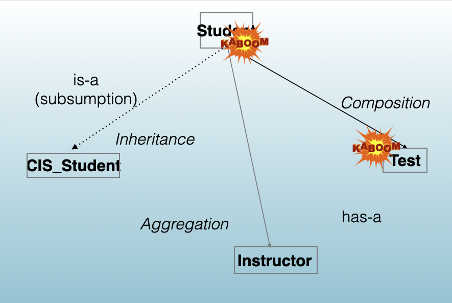
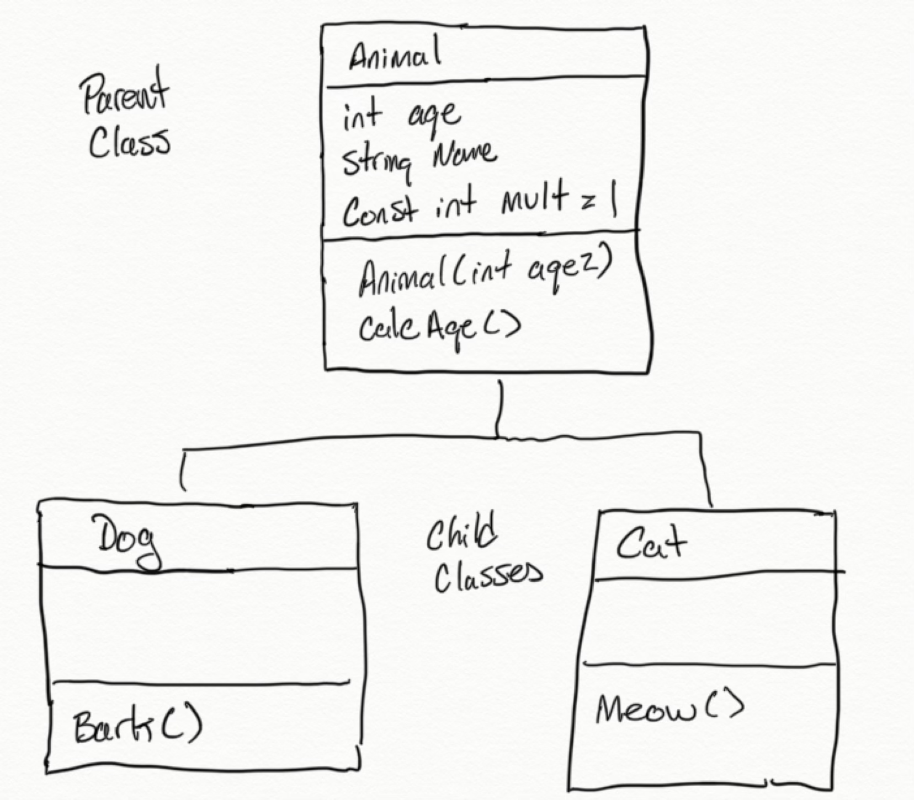
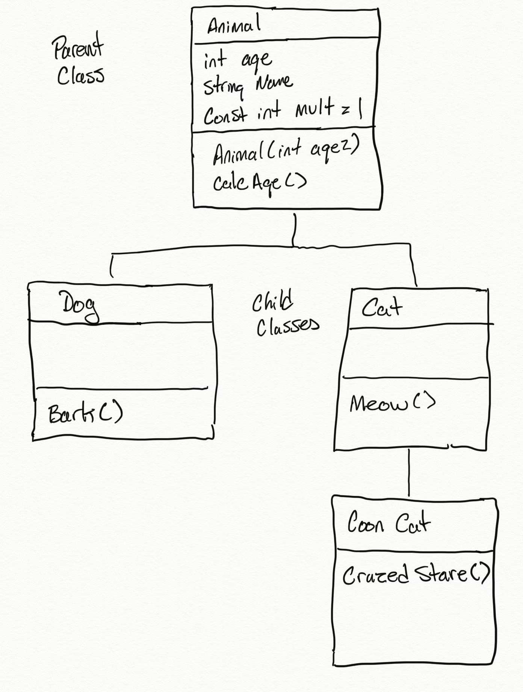
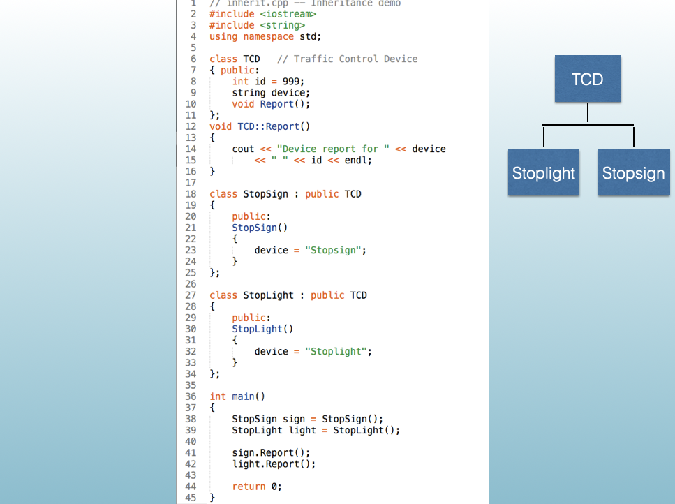
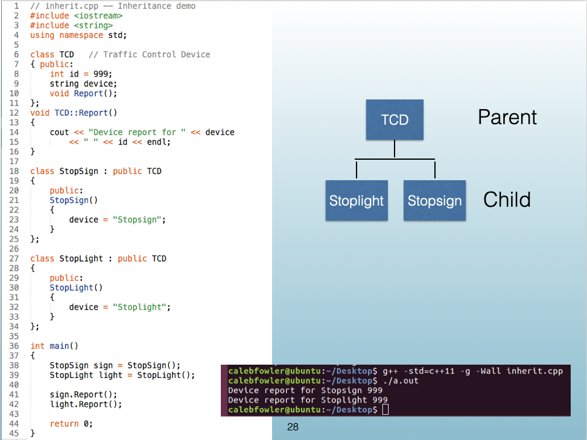

<!-- Topic 1: Is-a Versus Has-a -->
<!-- Slides 5–17 -->

# Is-a Versus Has-a
<!-- Slide 4 -->

## Remember This Diagram?

{width="80%" fig-align="center" fig-alt="The Student class diagram from 11.01: destroying a Student destroys its composed Test, while the Instructor and CIS_Student are not destroyed"}

::: notes
Slides 5–17

This is the Student diagram from 11.01. Thursday we followed the composition and aggregation arrows. Today we follow the one we set aside: the inheritance arrow.
:::

<!-- Slide 5 -->

---

## Is a Student a Person? {.smaller}

- Thursday's relationships were all has-a. Today a class *is* another class.

::: notes
Does a Student have a Person inside it, or is a Student a Person? Take a show of hands before moving on.
:::

<!-- Slide 6 -->

---

## The Is-a Test

- Say it out loud: "A ___ is a ___."
- "A Student is a Person." True: a Student has a name, an ID, and everything else a Person has. Inheritance.
- "A Car is an Engine." False. "A Car has an Engine." Composition.
- The sentence must hold for everything the base can do, not just sound right.

::: notes
The last bullet is the one students skip. The next slide is a class that passes the sentence test on a quick reading and fails it on the details.
:::

<!-- Slide 7 -->

---

## Animal, Dog, and Cat

{style="max-height: 56vh;" fig-align="center" fig-alt="Class diagram: parent class Animal with int age, string Name, const int mult = 1, Animal(int age2), and calcAge(). Child classes Dog with Bark() and Cat with Meow()."}

::: notes
Run the is-a test out loud: a Dog is an Animal, a Cat is an Animal. Both pass.

The parent holds what every animal has: age, Name, mult, the constructor, and calcAge(). Each child adds only what is special: Dog adds Bark(), Cat adds Meow(). Dog's attribute section is empty, yet a Dog still has an age and a name, because they come from Animal.

Ask: can a Cat call Bark()? No. Siblings share a parent, not each other's members.
:::

<!-- Slide 8 -->

---

## A Child Can Be a Parent

{style="max-height: 56vh;" fig-align="center" fig-alt="The same diagram with a third level: Coon Cat, with CrazedStare(), is a child of Cat."}

::: notes
A Coon Cat is a Cat, and a Cat is an Animal, so a Coon Cat is an Animal too. Coon Cat gets Meow() from Cat and age, Name, and calcAge() from Animal, and adds CrazedStare().

Cat is now both a child of Animal and a parent of Coon Cat. Topic 5 comes back to three levels to ask which part is built first.
:::

<!-- Slide 9 -->

---

## Another Example

<!-- Slide 10 -->

---

{fig-align="center" fig-alt="inherit.cpp: class TCD, a Traffic Control Device, with public id = 999, device, and Report(). StopSign and StopLight inherit publicly from TCD and set device in their constructors. A diagram shows TCD above Stoplight and Stopsign."}

::: notes
TCD is a Traffic Control Device. Run the is-a test: a stop sign is a traffic control device, and so is a stoplight.

TCD holds id, device, and Report(). StopSign and StopLight each write one constructor and nothing else. Ask students to predict what sign.Report() and light.Report() print before advancing.
:::

<!-- Slide 11 -->

---

{fig-align="center" fig-alt="The same inherit.cpp program with TCD labeled Parent and Stoplight and Stopsign labeled Child, and the terminal output: Device report for Stopsign 999, Device report for Stoplight 999."}

::: notes
Output:
Device report for Stopsign 999
Device report for Stoplight 999

Neither child wrote Report(), yet both can call it. Both print 999 because id is set once, in TCD.

Note for Topic 3: TCD's data is public, which is why the child constructors can assign device directly. Topic 3 makes that data private and shows what breaks.
:::

<!-- Slide 12 -->

---

## The Stack Trap

:::: {.columns}

::: {.column width="55%"}
::: {style="font-size: 55%;"}
~~~cpp
class Stack : public vector<int> {
    // no private vector: Stack IS a vector,
    // so the storage is inherited

public:
    void push(int value) { push_back(value); }
    int pop() {
        int top = back();
        pop_back();
        return top;
    }
    // no empty() here: it is inherited from vector
};

int main() {
    Stack s;
    s.push(1);
    s.push(2);
    s.insert(s.begin(), 99);   // inherited from vector
    s[1] = 42;                 // inherited from vector

    while (!s.empty()) {
        cout << s.pop() << " ";
    }
    return 0;
}
~~~
:::
:::

::: {.column width="45%"}
- A stack promises last in, first out: push 1, push 2, and pop gives back 2, then 1.
- "A Stack is a vector" sounds right, so this Stack inherits from `vector<int>`.
- Inheriting brings *every* vector function along, not just `push_back` and `pop_back`.
- Does it compile? What does it print?
:::

::::

::: notes
Have students commit to an answer before advancing. The two commented lines are the trap: neither function was written in Stack.

Answer: it compiles and prints 2 42 99. insert and operator[] were inherited from vector, and they let any caller break the stack's last-in, first-out promise.

Full program: cpp/stack_trap.cpp
:::

<!-- Slide 13 -->

---

## The Stack Trap

~~~cpp
class Stack {
private:
    vector<int> items;    // has-a: the vector is hidden inside

public:
    void push(int value) { items.push_back(value); }
    int pop() {
        int top = items.back();
        items.pop_back();
        return top;
    }
    bool empty() const { return items.empty(); }
};
~~~

- The inherited version printed `2 42 99`. A stack should give back only `2 1`.
- A Stack *uses* a vector; it is not one. Has-a shows only push, pop, and empty.

::: notes
With composition, s.insert(s.begin(), 99) no longer compiles: Stack has no member named insert. The class decides what callers may do. This is why the standard library's std::stack holds a container instead of inheriting from one.

Full program: cpp/stack_has_a.cpp
:::

<!-- Slide 14 -->

---

## Student and Instructor Share a Person

::: {style="font-size: 50%;"}
~~~cpp
class Person {
private:
    string name;
    int id = 0;

public:
    void setName(const string& n) { name = n; }
    void setId(int i) { id = i; }
    void print() const { cout << name << " (" << id << ")" << endl; }
};

class Student : public Person {      // a Student is a Person
private:
    string major;

public:
    void setMajor(const string& m) { major = m; }
};

class Instructor : public Person {   // an Instructor is a Person
private:
    string office;

public:
    void setOffice(const string& o) { office = o; }
};

int main() {
    Student ava;
    ava.setName("Ava");      // written once, in Person
    ava.setId(1001);
    ava.setMajor("CS");

    Instructor ng;
    ng.setName("Ng");        // the same code, reused
    ng.setId(7);
    ng.setOffice("BS 214");

    ava.print();
    ng.print();
    return 0;
}
~~~
:::

::: notes
Output:
Ava (1001)
Ng (7)

A preview: the syntax is Topic 2. For now, read : public Person as "is a Person." Point out that setName, setId, and print are written once, in Person, and both classes have them. Student and Instructor each add one member. The next slide names what that buys.

Full program: cpp/student_instructor.cpp
:::

<!-- Slide 15 -->

---

## What Does Inheritance Do For Me?

- Code shared by Student and Instructor is written once, in Person.
- A bug in Person is fixed in one place, and every derived class gets the fix.
- A Student can be used anywhere a Person is expected (13.02, polymorphism).

::: notes
The third bullet is the big one, and it is why the is-a test must hold for everything: code written for a Person will be handed a Student and must still work.
:::

<!-- Slide 16 -->

---

## Summary

- Inherit only when "A ___ is a ___" holds for everything the base can do.
- When a class only uses another class, has-a keeps the details hidden.

::: notes

:::

<!-- Slide 17 -->
