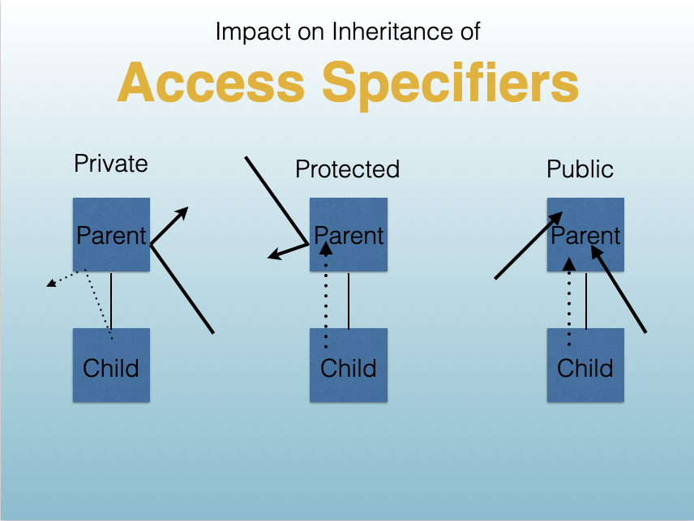

<!-- Topic 3: Inheritance Access Control -->
<!-- Slides 27–36 -->

# Inheritance Access Control
<!-- Slide 26 -->

## Can Student Read Its Own Name? {.smaller}

- Every Student holds a `name`. Can Student's own code use it?

::: notes
Slides 27–36

Most students will say yes: it is in the object. The next slide tries it.
:::

<!-- Slide 27 -->

---

{width="85%" fig-align="center" fig-alt="Three Parent and Child diagrams. Private: arrows from outside and the dotted arrow from the Child both bounce off the Parent. Protected: outside arrows bounce off, but the Child's dotted arrow reaches the Parent. Public: outside arrows and the Child's arrow all reach the Parent."}

::: notes
Solid arrows are outside code, such as main. Dotted arrows are the child class.

Private: everything bounces off, including the child. Protected: outside code bounces off, but the child gets in. Public: everyone gets in.

The next slide shows the private case in code, and the Who Can See What? table puts the whole picture in rows.
:::

<!-- Slide 28 -->

---

## private Means This Class Only

::: {style="font-size: 60%;"}
~~~cpp
class Person {
private:
    string name;

public:
    void setName(const string& n) { name = n; }
};

class Student : public Person {
private:
    string major;

public:
    void setMajor(const string& m) { major = m; }
    void print() const {
        cout << name << ", " << major << endl;   // error
    }
};
~~~
:::

- g++: `'std::string Person::name' is private within this context`
- A derived class is an outsider too. Student holds `name` but cannot touch it.

::: notes
private protects Person's invariants from everyone, including its children. If any derived class could write name, Person could no longer promise anything about it.

Full program: cpp/private_name.cpp
:::

<!-- Slide 29 -->

---

## Two Ways In

:::: {.columns}

::: {.column width="50%"}
::: {style="font-size: 50%;"}
~~~cpp
// Fix 1: name stays private,
// Student uses the public getter
class Person {
private:
    string name;

public:
    void setName(const string& n) { name = n; }
    string getName() const { return name; }
};

class Student : public Person {
private:
    string major;

public:
    void print() const {
        cout << getName() << ", " << major << endl;
    }
};
~~~
:::
:::

::: {.column width="50%"}
::: {style="font-size: 50%;"}
~~~cpp
// Fix 2: name is protected,
// derived classes use it directly
class Person {
protected:
    string name;

public:
    void setName(const string& n) { name = n; }
};

class Student : public Person {
private:
    string major;

public:
    void print() const {
        cout << name << ", " << major << endl;
    }
};
~~~
:::
:::

::::

::: notes
Both print Ava, CS. Fix 1 changes nothing about Person's data; Fix 2 opens name to every derived class, but still not to main. protected means family only. The decision slide at the end of this topic says which to prefer.

Full program: cpp/getter_vs_protected.cpp
:::

<!-- Slide 30 -->

---

## Who Can See What?

| Member is | Its own class | A derived class | Outside code, such as `main` |
|---|:-:|:-:|:-:|
| `public` | yes | yes | yes |
| `protected` | yes | yes | no |
| `private` | yes | no | no |

::: notes
protected sits between the other two: family only. This table assumes public inheritance, which is the only kind this course uses. The appendix shows what protected and private inheritance change.
:::

<!-- Slide 31 -->

---

## Which Compiles?

::: {style="font-size: 60%;"}
~~~cpp
class Member {
private:
    int dues = 20;

protected:
    string name = "Ben";

public:
    string getName() const { return name; }
};

class Officer : public Member {
public:
    void print() const {
        cout << name << endl;          // A
        cout << dues << endl;          // B
    }
};

int main() {
    Officer ben;
    ben.print();
    cout << ben.getName() << endl;     // C
    cout << ben.name << endl;          // D
    return 0;
}
~~~
:::

::: notes
Ask students which of A, B, C, and D compile, using the table on the previous slide. Have them commit before advancing; the answers are on the next slide.

Full program: cpp/access_predict.cpp
:::

<!-- Slide 32 -->

---

## Which Compiles?

::: {style="font-size: 60%;"}
~~~cpp
class Member {
private:
    int dues = 20;

protected:
    string name = "Ben";

public:
    string getName() const { return name; }
};

class Officer : public Member {
public:
    void print() const {
        cout << name << endl;   // A: compiles, protected: Officer is family
        cout << dues << endl;   // B: error, dues is private to Member
    }
};

int main() {
    Officer ben;
    ben.print();
    cout << ben.getName() << endl;   // C: compiles, getName is public
    cout << ben.name << endl;        // D: error, main is not family
    return 0;
}
~~~
:::

::: notes
A compiles: name is protected and Officer is a derived class.
B fails: dues is private to Member. g++: 'int Member::dues' is private within this context.
C compiles: getName is public.
D fails: main is outside code. g++: 'std::string Member::name' is protected within this context.

Only the family line, A, gets through protected. private stops even the family, and protected stops everyone else.

Full program: cpp/access_predict.cpp
:::

<!-- Slide 33 -->

---

## Forgot public

~~~cpp
class Student : Person {     // missing public
    ...
};

int main() {
    Student ava;
    ava.setName("Ava");      // error
}
~~~

- g++: `'void Person::setName(const string&)' is inaccessible within this context`
- Without `public`, a class inherits privately: everything from Person becomes private in Student. Always write `public`.

::: notes
This is the inheritance bug students will hit in Homework 6. The error points at main, not at the missing word, so it is hard to find. A struct inherits publicly by default; a class inherits privately. Private and protected inheritance are in the appendix; they break the is-a relationship and this course does not use them.

Full program: cpp/forgot_public.cpp
:::

<!-- Slide 34 -->

---

## When to Use protected

| Choose | When |
|---|---|
| `private` data, public getter | The default. Person keeps control of its own data |
| `protected` member function | A helper that derived classes need and outside code should not call |
| `protected` data | Rarely. Every derived class now depends on how Person stores it |

- Keep data private. Share behavior, not storage.

::: notes
If Person later splits name into first and last, Fix 1 changes one getter. With protected name, every derived class that used name breaks. Homework 6 accepts either, but the private-plus-getter version is easier to change.
:::

<!-- Slide 35 -->

---

## Summary

- `private` is this class only, `protected` is family only, and `public` is everyone.
- Write `public` when you inherit; without it a class inherits privately.

::: notes

:::

<!-- Slide 36 -->
