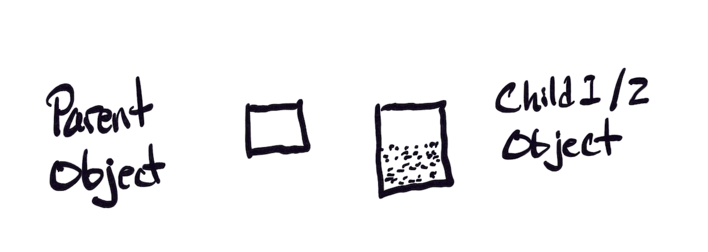
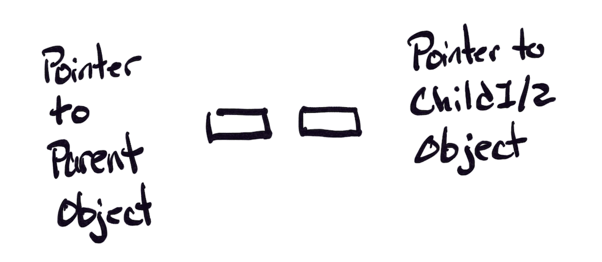

<!-- Topic 2: Object Slicing -->
<!-- Slides 18–25 -->

# Object Slicing
<!-- Slide 17 -->

## Now Comes the Real Test! {.smaller}

- We want to build a **mixed** array, and we want each object's specific method called. That is called **polymorphic** behavior.
- We know this means the array type will need to be of the parent class.

::: notes
Slides 18–25

A Hash, a Toy, a SHA256, and a SHA3 in one array, each displaying itself its own way. Ask students what they expect before the next slide.
:::

<!-- Slide 18 -->

---

## A Mixed Array

:::: {.columns}

::: {.column width="58%"}
::: {style="font-size: 55%;"}
~~~cpp
int main() {
  Hash myToys[4]{Hash("Hello World"), Toy("Semper Fi"),
    SHA256("The happiness of your life depends upon the quality of your thoughts."),
    SHA3("Done!")};

  for (auto h : myToys) h.Display();

return 0;
}
~~~
:::
:::

::: {.column width="42%"}
::: {style="font-size: 50%;"}
::: {.fragment}

~~~
Base text: Hello World
Base text: Semper Fi
Base text: The happiness of your life
depends upon the quality of your
thoughts.
Base text: Done!
~~~
:::
:::
:::

::::

::: notes
Four different classes go in, four Hashes come out. What went wrong?

Full program: cpp/hash_mixed_array.cpp
:::

<!-- Slide 19 -->

---

## What Went Wrong? Object Slicing

- **Object slicing:** copying a child object into a parent object keeps only the parent part. The child part is sliced off.
- It is the reason we don't have arrays of mixed objects in this language.
- Other OOP languages don't have to deal with this.

::: notes
Each element of Hash myToys[4] is exactly the size of a Hash. Copying a Toy into it copies only the Hash part; what made it a Toy is gone, so Hash's Display() is the only one left to run.

Java and C# avoid this because their variables of class type hold references to objects, never the objects themselves. C++ lets you store the object itself, which is faster and is also how slicing happens.
:::

<!-- Slide 20 -->

---

## Here's the Problem …

{style="max-height: 40vh;" fig-align="center" fig-alt="Hand drawing: a small empty box labeled Parent Object beside a larger box with extra contents labeled Child 1/2 Object."}

- If we build an array of Parent Objects and then throw Child objects into it, part of the Child objects will be sliced off.

::: notes
The child object is bigger: it has everything the parent has plus its own part. An array slot sized for a parent has no room for the rest.
:::

<!-- Slide 21 -->

---

## Dogs and Cats

:::: {.columns}

::: {.column width="62%"}
::: {style="font-size: 45%;"}
~~~cpp
// Parent class
class Animal {
public:
    // Base class function (non-virtual)
    void makeSound() const {
        cout << "Animal makes a generic sound." << endl;
    }
};

// Child class 1
class Dog : public Animal {
public:
    // Overriding makeSound (non-polymorphic)
    void makeSound() const {
        cout << "Dog barks: Woof! Woof!" << endl;
    }
};

// Child class 2
class Cat : public Animal {
public:
    // Overriding makeSound (non-polymorphic)
    void makeSound() const {
        cout << "Cat meows: Meow! Meow!" << endl;
    }
};

int main() {
    // Create child objects
    Dog dog;
    Cat cat;

    // Create an array of Animal objects
    Animal animals[2] = {dog, cat}; // Object slicing happens here

    // Call makeSound on each object in the array
    for (int i = 0; i < 2; ++i) {
        animals[i].makeSound(); // Calls Animal's version of makeSound
    }

    return 0;
}
~~~
:::
:::

::: {.column width="38%"}
::: {style="font-size: 50%;"}
::: {.fragment}

~~~
Animal makes a generic sound.
Animal makes a generic sound.
~~~
:::
:::
:::

::::

::: notes
A second example of the same problem, with the Animal, Dog, and Cat from 12.01. dog and cat are copied into Animal slots, and only the Animal part survives. Topic 4 fixes this exact program.

Full program: cpp/polyEx1.cpp
:::

<!-- Slide 22 -->

---

## We Need Something Uniform in Size

{style="max-height: 45vh;" fig-align="center" fig-alt="A man at a desk in front of a chalkboard covered in question marks, thinking."}

- We need something uniform in size between the Parent and Child Objects.

::: notes
Ask students: what in C++ is the same size no matter what it refers to?
:::

<!-- Slide 23 -->

---

## An Array of Pointers

{style="max-height: 35vh;" fig-align="center" fig-alt="Hand drawing: two small boxes of the same size, labeled Pointer to Parent Object and Pointer to Child 1/2 Object."}

- An array of pointers to objects is the only thing we can use, because pointers are the same size regardless of what they point to.
- … and to activate polymorphism, it will need to be an array of pointers to Parent objects.

::: notes
A pointer copies an address, never an object, so nothing gets sliced. A Hash* can point at a Toy because a Toy is a Hash (type compatibility from Topic 1).
:::

<!-- Slide 24 -->

---

## Summary

- Copying a child object into a parent object slices off the child part, so an array of parent objects can only hold parents.
- Pointers are all the same size, so an array of parent pointers can point at every kind of child without slicing.

::: notes

:::

<!-- Slide 25 -->
