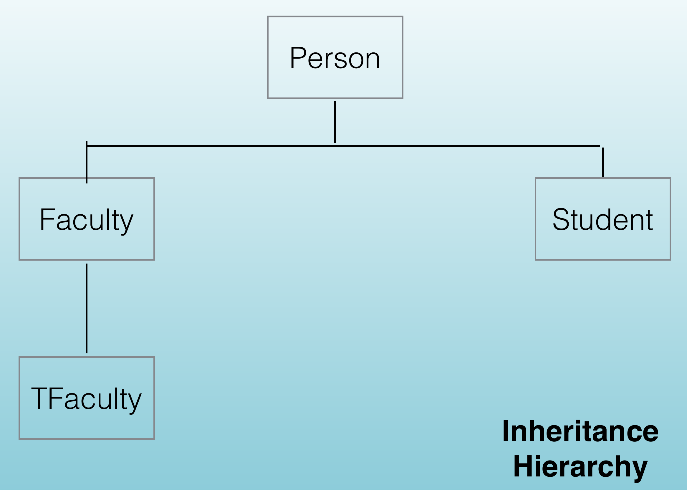

<!-- Topic 4: Virtual Functions -->
<!-- Slides 34–42 -->

# Virtual Functions
<!-- Slide 33 -->

## Virtual Member Function {.smaller}

- We use a virtual member function to turn on polymorphism.
- That tells the computer to use the most specific member function in an inheritance hierarchy.

::: notes
Slides 34–42

This is textbook section 15.2, Polymorphism and Virtual Member Functions. One keyword changes when the function is chosen: while the program runs, from the object, instead of while it compiles, from the pointer's type.
:::

<!-- Slide 34 -->

---

## Virtual Member Function

::: {style="font-size: 55%;"}
~~~cpp
class Hash {
protected:
  string plainText;
public:
  Hash(string str = "Empty") {plainText = str;
      cout << endl;  // prints a blank line each time a Hash is built
                     }
  virtual void Display(){cout << "Base text: " << plainText << endl;};
};

class Toy : public Hash {
public:
    Toy(const string& s) : Hash(s){};
  virtual void Display() {
    unsigned int hash = 0;
    for (char c : plainText)
      hash = hash * 31 + c;  // Simple multiplicative hash algorithm
    cout << "Toy Hash of '" << plainText << "': " << hash << endl;
  }
};
~~~
:::

::: notes
The only change from Topic 1 is the word virtual in front of Display(). SHA256 and SHA3 get it too in the full code, though only Hash's is required; the next slide but one explains why.

Full code: cpp/hash_classes_virtual.h
:::

<!-- Slide 35 -->

---

## The Pointer Array, Again

:::: {.columns}

::: {.column width="55%"}
::: {style="font-size: 55%;"}
~~~cpp
int main() {
  Hash* myToys[4];
  myToys[0] = new Hash("Hello World");
  myToys[1] = new Toy("Semper Fi");
  myToys[2] = new SHA256(
    "The happiness of your life depends upon the quality of your thoughts.");
  myToys[3] = new SHA3("Done!");

  for (auto h : myToys) h->Display();

return 0;
}
~~~
:::
:::

::: {.column width="45%"}
::: {style="font-size: 50%;"}
::: {.fragment}

~~~
Base text: Hello World
Toy Hash of 'Semper Fi': 1492142785
SHA-256 Hash of 'The happiness of
your life depends upon the quality
of your thoughts.': ***SHA-256***
SHA-3 Hash of 'Done!': ***SHA-3***
~~~
:::
:::
:::

::::

::: notes
Ask students to predict before revealing. main is unchanged from Topic 3; only Hash became virtual. Each element now runs its own Display(): one loop, four behaviors. That is polymorphism, and the choice made at run time is called dynamic binding.

Full program: cpp/hash_virtual_array.cpp
:::

<!-- Slide 36 -->

---

## Virtual Member Function Algorithm

- Determine what member you want to become polymorphic in the BASE class.
- Declare it with the `virtual` keyword.
    - Inheritable
    - Programmers often declare the function virtual in child classes. It is not necessary.

::: notes
Once a function is virtual in the base class, every override of it is virtual too, even without the keyword. Writing virtual again in the child is documentation. In 14.01, the override keyword asks the compiler to check that the child's function really matches.

The signature must match exactly, including const, as in 12.01. A child function with a different signature is a new function, not a virtual override.
:::

<!-- Slide 37 -->

---

## Back to the Person Hierarchy

:::: {.columns}

::: {.column width="40%"}
{style="max-height: 45vh;" fig-alt="Inheritance hierarchy: Person at the top, with Faculty and Student below it, and TFaculty below Faculty."}
:::

::: {.column width="60%"}
::: {style="font-size: 60%;"}
~~~cpp
// inheritance4.h -- demonstrate inheritance
class Person
{
    ...
    string getName() const {return name; }
};

// inheritance5.h -- demonstrate inheritance
class Person
{
    ...
    virtual string getName() const {return name; }      // NEW *****
};
~~~
:::
:::

::::

::: notes
The two headers are identical except for one word. TFaculty overrides getName() to put its title in front of the name.

Full code: cpp/inheritance4.h and cpp/inheritance5.h
:::

<!-- Slide 38 -->

---

## 15-3.cpp

:::: {.columns}

::: {.column width="62%"}
::: {style="font-size: 50%;"}
~~~cpp
// p15-3.cpp -- polymorphic behavior with virtual member functions
#include "inheritance5.h"       // ONLY CHANGE from p15-2.cpp
#include <vector>
#include <iostream>
using namespace std;

int main()
{
    vector<shared_ptr<Person>> people
    {
        make_shared<TFaculty>
        ("Indiana Jones", Discipline::ARCHEOLOGY, "Dr."),
        make_shared<Student>
        ("Tom Cruise", Discipline::COMPUTER_SCIENCE, nullptr),
        make_shared<Faculty>
        ("James Stock", Discipline::BIOLOGY),
        make_shared<TFaculty>
        ("Sharon ROck", Discipline::BIOLOGY, "Professor"),
        make_shared<TFaculty>
        ("Nicole Eweman", Discipline::ARCHEOLOGY, "Dr.")
    };

    for (int k = 0; k < people.size(); k++)
    {
        cout << people[k]->getName() << endl;
    }
    return 0;
}
~~~
:::
:::

::: {.column width="38%"}
::: {style="font-size: 50%;"}
::: {.fragment}

~~~
Dr. Indiana Jones
Tom Cruise
James Stock
Professor Sharon ROck
Dr. Nicole Eweman
~~~

- Now, the computer decides what code to run based upon the data: polymorphism.
:::
:::
:::

::::

::: notes
With inheritance4.h, p15-2.cpp prints the names with no titles: Person's getName() runs for everyone. With inheritance5.h, each TFaculty runs its own getName().

A vector of shared_ptr<Person> is the same idea as the Hash* array, with two advantages: it can grow, and the shared_ptrs delete the objects when the vector goes away. g++ -Wall warns about comparing int k with people.size(); size_t k avoids it.

Full programs: cpp/p15_2.cpp and cpp/p15_3.cpp
:::

<!-- Slide 39 -->

---

## Dogs and Cats, Fixed

:::: {.columns}

::: {.column width="62%"}
::: {style="font-size: 50%;"}
~~~cpp
class Animal {
public:
    // Base class function (virtual)
    virtual void makeSound() const {
        cout << "Animal makes a generic sound." << endl;
    }
};

// Dog and Cat as before

int main() {
    // Create child objects
    Dog dog;
    Cat cat;

    // Create an array of pointers to Animal
    Animal* animals[2] = {&dog, &cat}; // No slicing: pointers only

    // Call makeSound on each object in the array
    for (int i = 0; i < 2; ++i) {
        animals[i]->makeSound(); // Calls each object's own version
    }

    return 0;
}
~~~
:::
:::

::: {.column width="38%"}
::: {style="font-size: 50%;"}
::: {.fragment}

~~~
Dog barks: Woof! Woof!
Cat meows: Meow! Meow!
~~~
:::
:::
:::

::::

::: notes
Topic 2's Dogs and Cats with both fixes: virtual in Animal, and an array of Animal pointers instead of Animal objects. Ask students which fix alone would not be enough. Either one alone still prints the generic sound twice.

Full program: cpp/polyEx2.cpp
:::

<!-- Slide 40 -->

---

## Use Case

- Declare something virtual when you have a common overall structure, yet each primitive is different.
- You write the BASE class as public and virtual.
- You customize the derived classes.
- **Bottom Line: You make it virtual if you think the derived class might need to override it.**

::: notes
Hash is the example: every hash takes text and displays a result, but each kind computes it differently. Homework 6 asks for exactly this, a base class with a virtual function that each child overrides.
:::

<!-- Slide 41 -->

---

## Summary

- `virtual` in the base class turns polymorphism on: the object's class, not the pointer's type, picks the function at run time.
- Polymorphism needs both a virtual function and a pointer or reference to the base class.

::: notes

:::

<!-- Slide 42 -->
